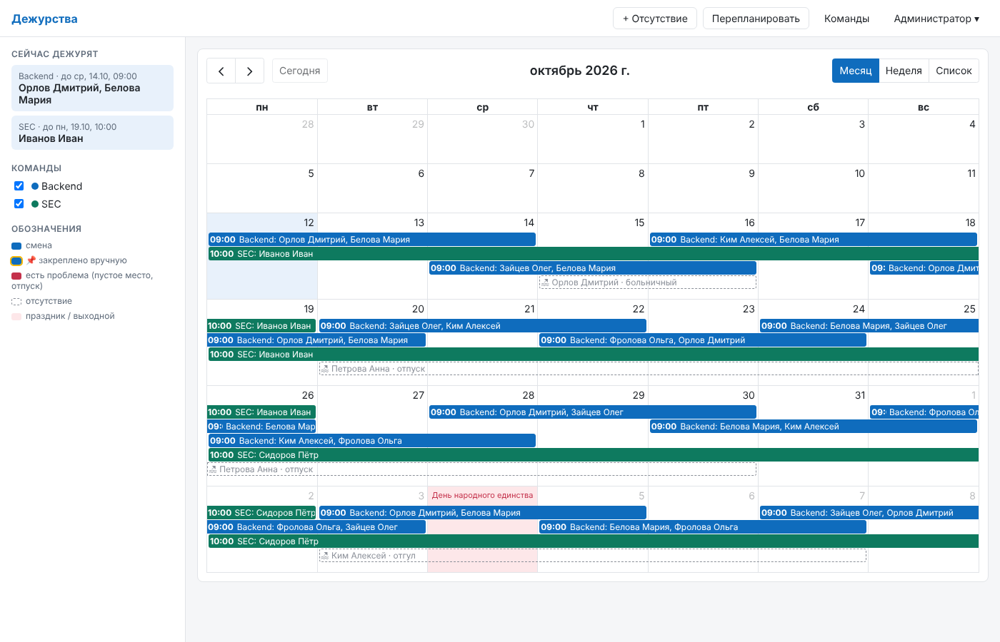

# duty-calendar

Сервис-календарь дежурств. Автоматически назначает дежурных с учётом отпусков, учитывает праздники РФ,
шлёт уведомления в Mattermost. Есть REST API, MCP-сервер и веб-интерфейс на FullCalendar.
Несколько команд, у каждой свой график и свои правила ротации.



## Возможности

- **Команды** — независимые графики. Правила задаются у команды:
  - длина смены в днях (1, 2, 7, …);
  - время передачи смены;
  - дата отсчёта сетки;
  - дни недели начала смены;
  - пропуск праздников по производственному календарю;
  - число дежурных на смену (N человек одновременно, все равноправные).
- **Автоназначение.** Дежурит тот, кто дольше всех не дежурил. При равенстве — тот, у кого меньше смен за
  полгода, затем по порядку в списке. Отсутствующий пропускает очередь и остаётся первым, поэтому после
  возвращения берёт ближайшую свободную смену.
- **Отпуска и отсутствия** вводятся вручную (веб, API, MCP). Для внешних источников есть интерфейс
  (Outlook/Exchange, HR-система, 1С).
- **Ручные правки:** назначить, освободить место, обменяться сменами. Ручное назначение закрепляет место (📌),
  и планировщик его не трогает.
- **Ручное дежурство поверх графика.** Клик по дню или протяжка по нескольким дням добавляет дежурство
  одного или нескольких людей на N календарных дней. Это отдельный слой: график ротации не меняется, слоёв в
  один день может быть несколько.
- **Даты любого дежурства можно поменять** в его карточке. У смены по графику меняются только её даты:
  ротация дальше не сдвигается, соседние смены остаются как есть. Кнопка «Вернуть даты графика» откатывает.
- **Дни без дежурства.** Смену по графику можно удалить, тогда эти дни остаются без дежурного и планировщик
  их не заполняет. Снятая смена показана пунктиром, её можно вернуть.
- **События** (не дежурства): релизы, учения, встречи — со своим цветом и участниками, для команды или для всех.
- **Отсутствия можно редактировать** (даты, тип, комментарий) с предпросмотром последствий.
- **Цвет дежурств** переключается: по людям (каждый человек своим цветом, несколько дежурных в один день —
  отдельные полосы) или по командам.
- **Предпросмотр.** Любое изменение (отсутствие, перепланирование) можно сначала посмотреть в режиме `dry_run`.
- **Праздники РФ** видны в календаре и могут исключаться из сетки смен.
- **Mattermost:** начало смены, перестановки, конфликты, ручные изменения.
- **ICS-подписка** на смены команды для Outlook, телефона и т.п.
- **Exchange** — подготовлены интерфейс публикации смен и учёт изменённых смен (`publish_dirty`), реализация
  будет добавлена.

## Быстрый старт

### Docker

```bash
cp .env.example .env        # задайте DUTY_ADMIN_PASSWORD
docker compose up -d --build
open http://localhost:8000  # вход: admin / пароль из .env
```

### Локально

```bash
python -m venv .venv && . .venv/bin/activate
pip install -e ".[dev]"
DUTY_ADMIN_PASSWORD=admin-pass-123 python -m duty
# демо-данные (две команды, люди, отпуска):
python scripts/demo_data.py http://localhost:8000 admin admin-pass-123
```

Документация API (Swagger) открывается на `/docs`.

## Как работает планирование

**Сетка смен.** Смена длится `shift_length_days` *дежурных* дней и передаётся в `handoff_time` по часовому
поясу команды. Какие дни дежурные:
- `weekdays`: дежурные дни недели;
- `skip_holidays`: праздники и перенесённые выходные не дежурные, перенесённые рабочие дни (рабочая суббота)
  дежурные.

Смена никогда не захватывает недежурные дни. Если её дни разорваны выходными или праздником, она
продолжается после них у того же человека. Например, при 2 днях и Пн–Пт: `[пн–вт] [ср–чт] [пт + пн] [вт–ср] …`.
Если дежурные все дни (`1234567`, без производственного календаря) — обычная круглосуточная сетка от
`anchor_date`.

Примеры:

| Ротация | Настройки |
|---|---|
| Недельная 24/7, передача в пн 10:00 | `shift_length_days=7`, `anchor_date`=понедельник, `weekdays=1234567`, `skip_holidays=false` |
| По двое рабочих суток | `shift_length_days=2`, `weekdays=12345`, `skip_holidays=true` |
| Посуточно только в рабочие дни | `shift_length_days=1`, `weekdays=12345`, `skip_holidays=true` |
| Двое дежурных одновременно | `people_per_shift=2` |

**Когда запускается.** Каждые 30 минут, а также сразу после изменения отсутствий, состава или правил команды:
1. сетка продлевается на `horizon_days` вперёд;
2. планировщик запускается в режиме **fix**.

**Режимы:**
- **fix** (автоматически) меняет только «сломанные» места: человек отсутствует, выключен из ротации, или место
  пустое. Остальные назначения остаются, чтобы не было лишних перестановок.
- **rebalance** (вручную) пересчитывает всё будущее, кроме закреплённых мест и ближайших `freeze_days` дней.
  Число дней можно переопределить параметром `freeze_days` (0 — пересчитать всё, кроме уже начавшихся смен).
- **Новый участник** (добавлен или включён в ротацию) и **изменение отсутствия** (добавление, правка, удаление)
  запускают rebalance с `freeze_days=0`: очередь остаётся ровной, а не только «чинится» одна смена. Закреплённые,
  уже начавшиеся и снятые смены не трогаются.

**Что планировщик никогда не меняет.** Закреплённые места и уже начавшиеся смены. Если там проблема
(дежурный ушёл в отпуск), это **конфликт**: смена подсвечивается в календаре, в Mattermost уходит
предупреждение, решает человек.

**Частичное отсутствие** (отпуск задевает часть смены). Поведение задаёт стратегия `absence_policy`:
- `whole` (реализовано): место переходит другому целиком;
- `split` (заготовка `SplitShiftPlanner`): делить смену по границам отсутствия.

**Смена правил.** Если правила команды поменялись, незакреплённые будущие смены пересоздаются по новой сетке.

## Доступ

- **Роли:**
  - `user` — смотрит график, назначает, меняется сменами, ведёт отсутствия, перепланирует;
  - `admin` — дополнительно управляет командами, составом, людьми, пользователями, праздниками.
- **Первый админ** создаётся при старте из `DUTY_ADMIN_USERNAME` / `DUTY_ADMIN_PASSWORD`, если пользователей
  ещё нет.
- **Веб:** вход по логину и паролю, сессия в HttpOnly-cookie.
- **API, MCP и ICS:** личный токен (меню пользователя → «Токены»), передаётся как
  `Authorization: Bearer <токен>`. Для ICS токен передаётся параметром `?token=…`.
- **AD/LDAP:** под будущий вход оставлен интерфейс `AuthBackend` (заготовка `LdapAuthBackend`).

## MCP

Endpoint: `http://<host>:8000/mcp/` (Streamable HTTP), авторизация — личный токен.

```json
{
  "mcpServers": {
    "duty": {
      "type": "http",
      "url": "http://duty.company.ru:8000/mcp/",
      "headers": { "Authorization": "Bearer dtp_..." }
    }
  }
}
```

Инструменты:
- **чтение:** `list_teams`, `who_is_on_call`, `get_schedule`, `list_absences`, `list_holidays`;
- **изменения:** `add_absence`, `update_absence`, `remove_absence`, `set_manual_shift`, `set_shift_dates`,
  `reset_shift_dates`, `delete_shift`, `restore_shift`, `assign_shift`, `free_seat`, `unpin_shift`, `swap_shifts`,
  `replan` (по умолчанию `dry_run=true`);
- **события:** `list_events`, `add_event`, `update_event`, `delete_event`;
- **для админа:** `add_member`, `set_member_active`, `remove_member`.

Примеры запросов: «Боря в отпуске 3–14 ноября, покажи, что поменяется», «кто дежурит в SEC на праздниках»,
«поменяй мою смену 20-го с Викой».

## REST API (основное)

| Метод | Путь | Что делает |
|---|---|---|
| POST | `/api/v1/auth/login` | вход (cookie) |
| GET/POST | `/api/v1/me/tokens` | личные токены |
| GET/POST | `/api/v1/teams` | команды |
| PATCH/DELETE | `/api/v1/teams/{slug}` | правила команды |
| POST/PUT | `/api/v1/teams/{slug}/members` | добавить участника / задать порядок |
| PATCH/DELETE | `/api/v1/teams/{slug}/members/{email}` | включить/выключить, убрать |
| GET | `/api/v1/teams/{slug}/oncall?at=` | кто дежурит |
| POST | `/api/v1/teams/{slug}/plan?mode=fix\|rebalance&dry_run=` | перепланировать |
| GET | `/api/v1/teams/{slug}/calendar.ics?token=` | ICS-подписка |
| GET | `/api/v1/shifts?team=&person=&start=&end=` | смены |
| POST | `/api/v1/shifts/{id}/assign` | `{email, seat, force}` — назначить (закрепляет); `email=null` — освободить |
| POST | `/api/v1/teams/{slug}/shifts` | `{start_date, days, emails, force}` — ручное дежурство поверх графика |
| PATCH | `/api/v1/shifts/{id}` | `{start, end, force}` — изменить даты дежурства |
| POST | `/api/v1/shifts/{id}/reset-period` | вернуть смене даты графика |
| DELETE | `/api/v1/shifts/{id}` | удалить дежурство (смена по графику снимается — дни без дежурного) |
| POST | `/api/v1/shifts/{id}/restore` | вернуть снятую смену |
| GET/POST/PATCH/DELETE | `/api/v1/events` | события (не дежурства) |
| POST | `/api/v1/shifts/{id}/unpin` | снять закрепление |
| POST | `/api/v1/shifts/swap` | обмен местами между сменами |
| GET | `/api/v1/shifts/{id}/log` | история изменений смены |
| GET/POST | `/api/v1/absences?dry_run=` | отсутствия: даты `YYYY-MM-DD` включительно или ISO-время |
| PATCH | `/api/v1/absences/{id}?dry_run=` | изменить отсутствие |
| DELETE | `/api/v1/absences/{id}?dry_run=` | удалить отсутствие |
| GET/PUT | `/api/v1/holidays` | производственный календарь, ручные дни |
| POST | `/api/v1/holidays/sync` | загрузить праздники от провайдера |
| GET | `/api/v1/calendar?start=&end=&teams=` | смены + отсутствия + праздники (для веба) |

## Производственный календарь

Источник задаётся в `DUTY_HOLIDAY_PROVIDER`:
- `library` (по умолчанию, без интернета): пакет `holidays`, официальные праздники. **Не знает переносов**
  выходных (например, 9 января или 31 декабря 2026), их можно добавить вручную: `PUT /api/v1/holidays`.
- `isdayoff`: isdayoff.ru, учитывает переносы и сокращённые дни. Нужен доступ в интернет.

Праздники на текущий и следующий год загружаются автоматически. Дни, добавленные вручную, имеют приоритет.

## Точки расширения

| Что | Где | Статус |
|---|---|---|
| Публикация смен в Exchange (встречи с приглашениями) | `duty/integrations/exchange.py` → `ExchangePublisher` | заготовка с планом на `exchangelib` |
| Отпуска из Outlook (free/busy, статус OOF) | `duty/integrations/exchange.py` → `ExchangeFreeBusySource` | заготовка |
| Другие источники отпусков | реализовать `AbsenceSource` в `duty/integrations/absences.py` | интерфейс |
| Другие календари | реализовать `CalendarPublisher` в `duty/integrations/publishers.py` | есть `none` и `log` |
| Деление смены при частичном отсутствии | `SplitShiftPlanner` в `duty/planning/planner.py` | заготовка |
| Вход через AD/LDAP | `LdapAuthBackend` в `duty/auth.py` | заготовка |
| Другой мессенджер | реализовать `Notifier` в `duty/integrations/notifiers.py` | есть Mattermost |

## Структура

```
duty/
  planning/slots.py      сетка смен по правилам ротации
  planning/planner.py    интерфейс Planner, WholeShiftPlanner, SplitShiftPlanner (заготовка)
  services.py            все операции (используются API, MCP и фоновыми задачами)
  api.py                 REST API
  mcp_server.py          MCP-инструменты
  auth.py                пароли, токены, бэкенды входа
  integrations/          праздники, Mattermost, публикация в календарь, источники отпусков, Exchange
  static/                веб-интерфейс (FullCalendar встроен, CDN не нужен)
tests/                   pytest: планировщик, API, MCP, праздники
scripts/demo_data.py     демо-данные
```

## Тесты

```bash
pytest -q
```

## Ограничения текущей версии

- Один экземпляр сервиса: фоновые задачи и блокировка изменений рассчитаны на это.
- Миграций схемы БД пока нет (`create_all`). При изменении моделей нужно будет добавить Alembic.
- Exchange, внешние источники отпусков, LDAP и стратегия `split` — только интерфейсы.
